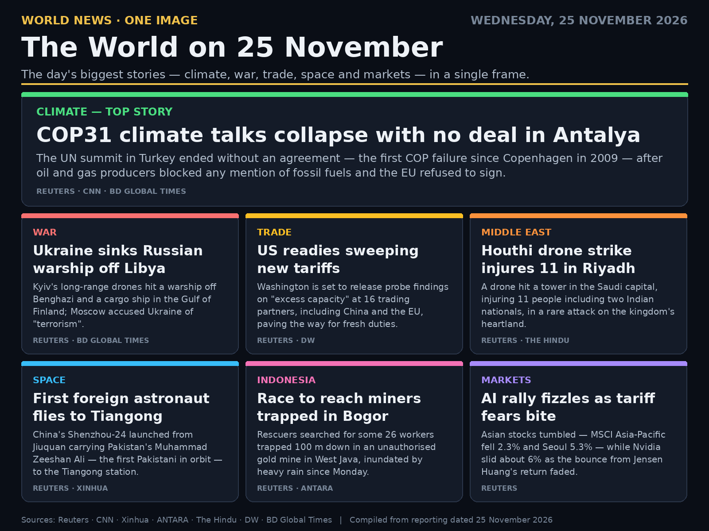

# The World on 25 November 2026 — in one image

[](https://make.fun/bounty/news-image-20261125?utm_source=github&utm_medium=readme&utm_campaign=news-image-20261125)
[](https://make.fun/bounty/news-image-20261125/leaderboard?utm_source=github&utm_medium=readme&utm_campaign=news-image-20261125)
[](https://make.fun/bounty/news-image-20261125?utm_source=github&utm_medium=readme&utm_campaign=news-image-20261125)

A single 1600×1200 infographic that sums up the world news of **Wednesday,
25 November 2026**: one featured story plus six panels, each with a headline
and a one-line summary, compiled from wire reporting dated that day.



## Regenerate the image

```sh
python3 main.py   # writes news-2026-11-25.png
```

`main.py` uses only Python 3 + Pillow and the system DejaVu fonts. It is
fully deterministic — no network, no randomness — and re-running it
reproduces the committed PNG byte for byte. A built-in fit guard measures
every summary with PIL and steps the type size down until nothing can
overflow its panel.

## The day's stories, with sources

1. **CLIMATE — COP31 climate talks collapse with no deal in Antalya.**
   The UN summit in Turkey ended without an agreement — the first COP
   failure since Copenhagen in 2009 — after oil and gas producers blocked
   any mention of fossil fuels and the EU refused to sign. Fallout coverage
   led the world's front pages on 25 November.
   Sources: [Reuters](https://www.reuters.com/sustainability/cop31-was-flop-what-now-2026-11-24/),
   [CNN](https://www.cnn.com/2026/11/22/climate/cop31-summit-collapses-in-fossil-fuel-failure?cid=external-feeds_iluminar_meta),
   [BD Global Times](https://bdglobaltimes.com/en/category/international-news/)

2. **WAR — Ukraine sinks Russian warship off Libya.**
   Kyiv's long-range drones hit a warship off Benghazi and a cargo ship in
   the Gulf of Finland; Moscow accused Ukraine of "terrorism".
   Sources: [BD Global Times](https://bdglobaltimes.com/en/category/international-news/),
   [WH News](https://wh.news/world),
   [Reuters podcast](https://www.reuters.com/podcasts/huangs-return-ukraine-war-spreads-libya-iowa-detonation-2026-11-24/)

3. **TRADE — US readies sweeping new tariffs.**
   Washington is set to release probe findings on "excess capacity" at 16
   trading partners, including China and the EU, paving the way for fresh
   duties.
   Sources: [Reuters](https://www.reuters.com/world/china/global-markets-global-markets-2026-11-25/),
   [Newsreel](https://newsreel.com.au/article-categories/world/)

4. **MIDDLE EAST — Houthi drone strike injures 11 in Riyadh.**
   A drone hit a tower in the Saudi capital, injuring 11 people including
   two Indian nationals, in a rare attack on the kingdom's heartland.
   Sources: [The Hindu (via Newsmriti)](https://srihayavadhana.com/newsmriti/headlines/),
   [Huddle World headlines](https://www.huddleworld.com/index.php/headlines/headlines-general)

5. **SPACE — First foreign astronaut flies to Tiangong.**
   China's Shenzhou-24 launched from Jiuquan carrying Pakistan's Muhammad
   Zeeshan Ali — the first Pakistani in orbit — to the Tiangong station.
   Sources: [Reuters](https://www.reuters.com/science/chinas-shenzhou-24-space-flight-takes-off-with-pakistani-national-first-foreign-2026-11-25/),
   [Xinhua](http://eng.chinamil.com.cn/2025xb/H_251454/L_251456/16501874.html)

6. **INDONESIA — Race to reach miners trapped in Bogor.**
   Rescuers searched for some 26 workers trapped 100 m down in an
   unauthorised gold mine in West Java, inundated by heavy rain since
   Monday.
   Sources: [Reuters](https://www.reuters.com/world/asia-pacific/indonesian-rescuers-search-possibly-dozens-trapped-mine-2026-11-25/),
   [ANTARA (via Jawawa)](https://jawawa.id/newsitem/26-people-trapped-in-bogor-illegal-gold-mine-since-monday-1795575142)

7. **MARKETS — AI rally fizzles as tariff fears bite.**
   Asian stocks tumbled — MSCI Asia-Pacific fell 2.3% and Seoul 5.3% —
   while Nvidia slid about 6% as the bounce from Jensen Huang's return
   faded.
   Sources: [Reuters](https://www.reuters.com/world/china/global-markets-global-markets-2026-11-25/),
   [Reuters Trading Day](https://www.reuters.com/commentary/reuters-open-interest/global-markets-trading-day-graphic-2026-11-24/)

## License

MIT — see [LICENSE](LICENSE).
